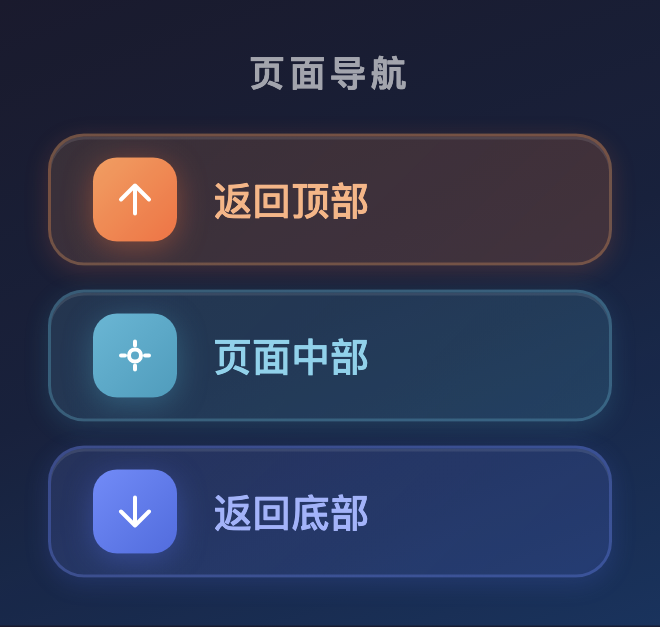
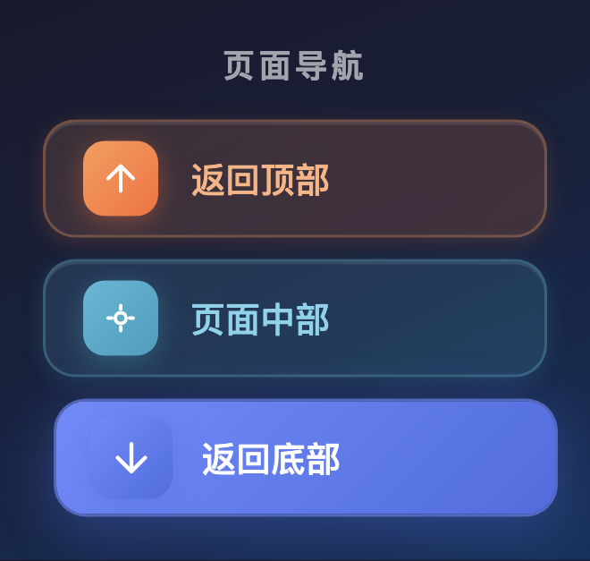
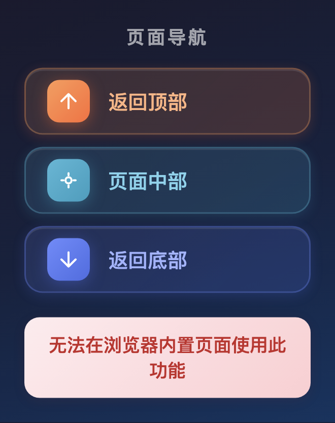

# Scroll Goto Button

> 一个轻量的 Chrome 扩展：把长页面快速带到顶部、中部或底部。

点击浏览器工具栏上的图标，在弹窗里选择目标位置，当前页面就会平滑滚动过去，不再需要长时间拖拽滚动条。



## 功能

| 功能 | 说明 |
| --- | --- |
| 返回顶部 | 直接定位到页面最上方 |
| 页面中部 | 定位到可滚动范围的中间位置 |
| 返回底部 | 定位到页面最末尾，不留空白 |
| 平滑滚动 | 使用浏览器原生 `behavior: 'smooth'` 动画 |
| 悬停反馈 | 按钮高亮、图标放大、整体轻微右移 |
| 页面检测 | 无法注入的页面会给出提示，不会静默失败 |

## 界面与交互

### 主界面

弹窗宽 220px，深色渐变背景上排列三个按钮，每个按钮配一个方向图标和独立的主题色：

- **返回顶部**：日出橙，向上箭头
- **页面中部**：海洋蓝，中心定位图标
- **返回底部**：极光蓝，向下箭头

按钮布局紧凑，打开弹窗即可直接点击，没有多余的设置项。

### 悬停与点击反馈



鼠标悬停时，按钮会填充对应的渐变底色、文字转为白色，同时整体右移 4px、图标放大到 1.1 倍，用来提示当前指向的是哪个操作。按下时按钮会轻微缩小并回弹，形成点击反馈。

三个按钮的动效参数一致，只有配色不同，切换时视觉上不会突兀。

### 受限页面提示



扩展通过 `chrome.scripting` 注入脚本，而浏览器内置页面不允许注入。遇到这类页面时，弹窗底部会出现浅红色提示条「无法在浏览器内置页面使用此功能」，3 秒后自动消失，避免误以为按钮失效。

判定逻辑覆盖以下协议：

```
chrome:  chrome-extension:  edge:  brave:  about:  file:  data:  javascript:
```

其中 `file://` 默认同样不放开注入权限，因此本地 HTML 文件也会走提示分支。

## 三种滚动落点


三个按钮共用一套位置计算，落点都落在「可滚动范围」内，不会滚过头，也不会因为取整而在底部留下空隙：

| 目标 | 计算公式 |
| --- | --- |
| 顶部 | `0` |
| 中部 | `(scrollHeight - clientHeight) / 2` |
| 底部 | `scrollHeight - clientHeight` |

页面总高度取 `document.documentElement.scrollHeight` 与 `document.body.scrollHeight` 的较大值，兼容以 `html` 或 `body` 作为滚动容器的站点；视口高度统一使用 `document.documentElement.clientHeight`。

## 安装

1. 下载或克隆本项目
2. 打开 Chrome，访问 `chrome://extensions/`
3. 开启右上角的「开发者模式」
4. 点击「加载已解压的扩展程序」
5. 选择本项目所在的 `scroll-goto-button` 目录
6. 安装完成后，可在工具栏的扩展菜单中把图标固定到显眼位置

扩展没有构建步骤，也不依赖任何第三方库，加载目录即可使用。

## 使用

1. 打开任意网页
2. 点击工具栏上的扩展图标，弹出操作面板
3. 点击「返回顶部」「页面中部」或「返回底部」
4. 页面平滑滚动到对应位置

点击按钮不会关闭弹窗，可以在三个位置之间连续切换。

## 工作原理

`popup.js` 在点击按钮时完成三件事：

```js
// 1. 获取当前活动标签页
const [tab] = await chrome.tabs.query({ active: true, currentWindow: true });

// 2. 检查页面是否允许注入
if (isRestrictedPage(tab.url)) return showError('无法在浏览器内置页面使用此功能');

// 3. 注入一次性脚本并滚动
await chrome.scripting.executeScript({
  target: { tabId: tab.id },
  func: (pos) => {
    const scrollHeight = Math.max(
      document.documentElement.scrollHeight,
      document.body.scrollHeight
    );
    const clientHeight = document.documentElement.clientHeight;
    let targetPosition;

    switch (pos) {
      case 'top':    targetPosition = 0; break;
      case 'middle': targetPosition = (scrollHeight - clientHeight) / 2; break;
      case 'bottom': targetPosition = scrollHeight - clientHeight; break;
    }

    window.scrollTo({ top: targetPosition, behavior: 'smooth' });
  },
  args: [position]
});
```

注入的脚本只在点击的瞬间执行一次，滚动结束后即退出，不常驻页面。

### 权限说明

| 权限 | 用途 |
| --- | --- |
| `activeTab` | 仅在点击扩展图标后临时获得当前标签页的访问权 |
| `scripting` | 向当前标签页注入一次滚动脚本 |

扩展没有后台脚本（background / service worker），不读取页面内容，不发起网络请求，也不收集任何数据。

## 已知限制

- `chrome://`、`chrome-extension://`（含扩展管理页、Chrome 应用商店）、`file://` 等页面不允许注入脚本，只能给出提示
- 滚动作用于文档本身；如果页面使用内部容器（如 `overflow: auto` 的 `div`）承载长内容，扩展无法滚动该容器
- PDF 查看器、部分阅读器类页面使用浏览器原生渲染，注入的滚动逻辑可能不生效

## 项目结构

```
scroll-goto-button/
├── manifest.json          # 扩展配置（Manifest V3）
├── popup.html             # 弹窗结构
├── popup.css              # 弹窗样式与交互动效
├── popup.js               # 页面检测与滚动注入
├── icons/                 # 扩展图标
│   ├── icon16.png
│   ├── icon48.png
│   ├── icon128.png
│   └── icon.svg
├── docs/
│   └── images/            # README 截图
│       ├── popup.png
│       ├── popup-hover.png
│       ├── popup-error.png
│       └── scroll-positions.png
└── README.md
```

## 开发调试

1. 打开 `chrome://extensions/`，找到本扩展
2. 修改代码后点击卡片上的刷新按钮
3. 若弹窗正处于打开状态，先在弹窗内按 `Cmd+R`（macOS）或 `Ctrl+R`（Windows / Linux）重新加载，再重新打开

弹窗的调试信息可在扩展卡片的「检查视图」中查看。

## 技术栈

- 原生 HTML / CSS / JavaScript，无框架、无构建
- Chrome Extension Manifest V3
- 建议 Chrome 88 及以上版本（`chrome.scripting` API 的要求）
